# Real Scout: Flutter Real Estate App

A real-estate mobile app built in Flutter from a Figma design, as a practical hiring assessment for a **Flutter Mobile Developer** role.

- **Figma-faithful UI** for 7 screens (Splash, Auth, Home, Explore, Filter sheet, Property Details, Profile).
- **Arabic and English**, switchable in the app without a restart, with a full **RTL/LTR** layout flip. The choice is saved and restored on the next launch.
- **Live data from the [DummyJSON](https://dummyjson.com/docs/products) API**: products are shown as properties, with loading, empty, error, offline and retry states.
- **Search and filtering**: debounced paged search, plus a filter sheet (several categories and a price range with a histogram).
- **Clean Architecture** with Cubit state management, and **1,050+ automated tests**.

Repository: <https://github.com/AnasAlhamadd/flutter-real-estate-assessment>

---

## Table of contents

1. [Screens](#1-screens)
2. [Screenshots](#2-screenshots)
3. [Requirements](#3-requirements)
4. [Getting started](#4-getting-started)
5. [API base URL](#5-api-base-url)
6. [Architecture](#6-architecture)
7. [State management](#7-state-management)
8. [API integration](#8-api-integration)
9. [Search and filtering](#9-search-and-filtering)
10. [Arabic/English and RTL/LTR](#10-arabicenglish-and-rtlltr)
11. [Responsive layout and design fidelity](#11-responsive-layout-and-design-fidelity)
12. [Packages and why they are used](#12-packages-and-why-they-are-used)
13. [Tests](#13-tests)
14. [Assumptions and known limitations](#14-assumptions-and-known-limitations)
15. [AI usage](#15-ai-usage)
16. [Git history](#16-git-history)

---

## 1. Screens

Design: [Real Estate Mobile App Design (Figma Community)](https://www.figma.com/design/dXUFyRx7RgaaS0lGWPPFd3/Real-Estate-Mobile-App-Design--Community-?node-id=0-1). The top-level blue color set (primary `#0061FF`) is implemented.

| Screen | Figma node | Route | What it does |
| --- | --- | --- | --- |
| Splash | `1:4551` | `/splash` | Logo, app name and tagline, then opens Auth after 1.5 s |
| Auth | `1:4499` | `/auth` | Design-only sign-in page. "Sign Up with Google" explains that sign-in isn't available; "Continue as guest" opens Home |
| Home | `1:4426` | `/` (tab) | Greeting, search bar, Featured carousel (top rated), category chips, recommendations grid with infinite scroll |
| Explore | `1:4120` | `/explore` (tab) | Debounced search, "Found N results", list cards, infinite scroll, filter icon |
| Filter sheet | `1:3867` | bottom sheet over Explore | Price histogram + range slider, multi-select categories, Reset, Set Filter |
| Property Details | `1:4236` | `/property/:id` | Photo carousel, title, category, rating, stats, agent, overview, facilities, gallery, location, reviews, price bar |
| Profile | `1:3786` | `/profile` (tab) | Guest profile with the **Language** row that opens the language picker |

**Navigation flow:** Splash → Auth → Home. Home, Explore and Profile are bottom-navigation tabs (`StatefulShellRoute`, each tab keeps its own state and scroll position). Property Details is pushed over the tabs from any card. Unknown routes and invalid property ids show a localized "page not found" screen.

---

## 2. Screenshots

Screenshots of every screen in both languages are in [`docs/screenshots/`](docs/screenshots/).

| Screen | English (LTR) | Arabic (RTL) |
| --- | --- | --- |
| Home | 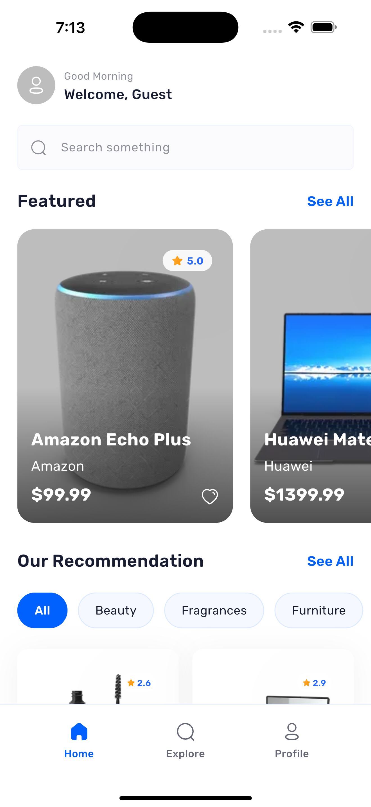 | 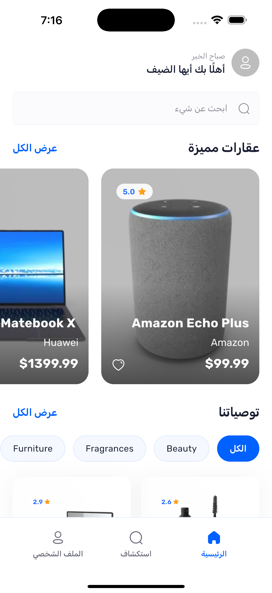 |
| Explore | 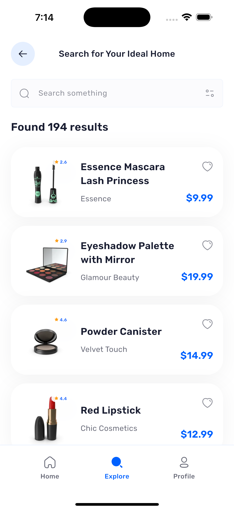 | 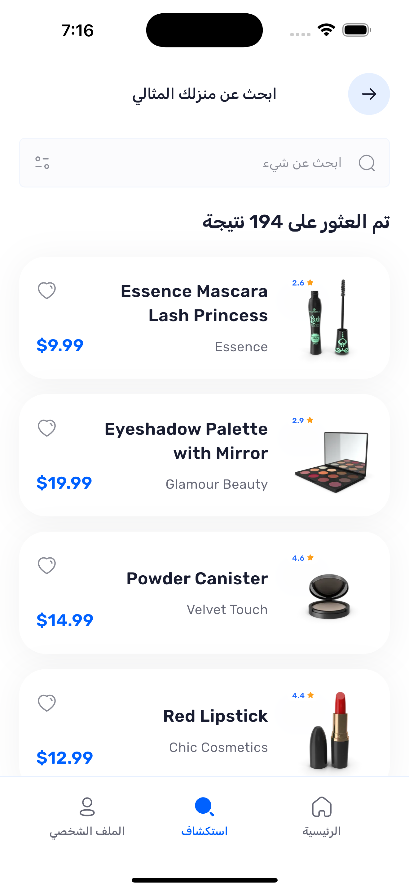 |
| Filter sheet | 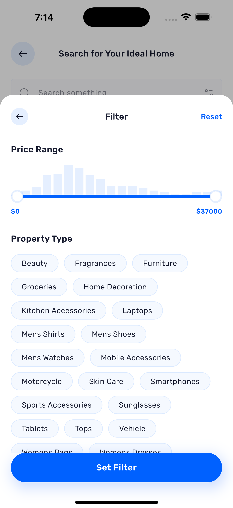 | 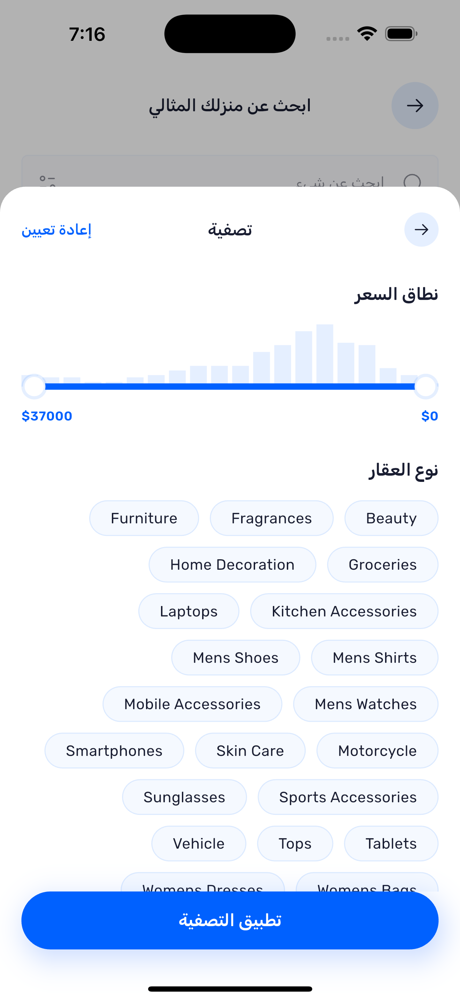 |
| Property Details | 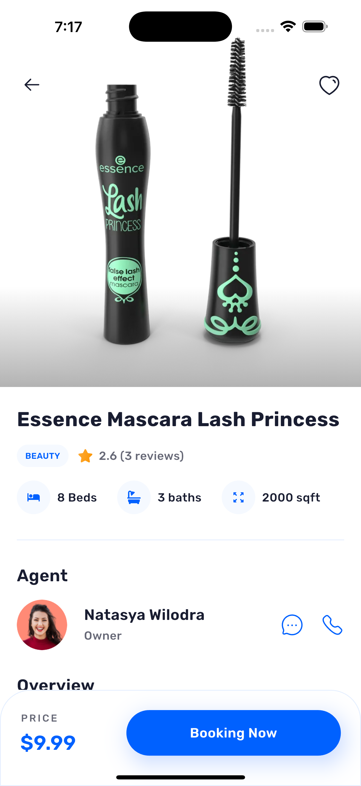 | 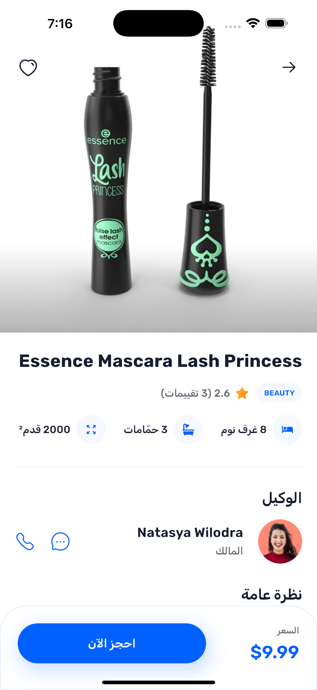 |
| Profile + language picker | 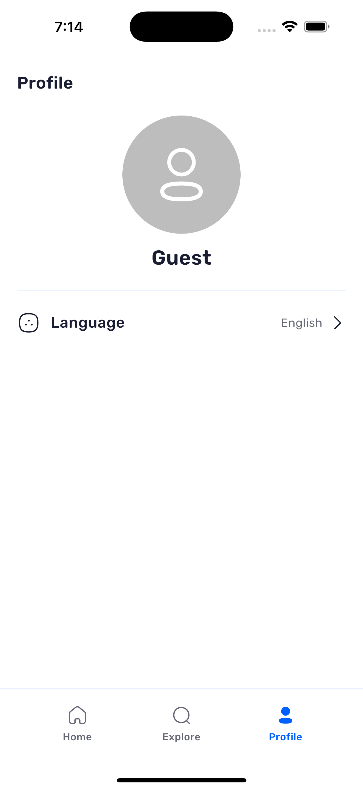 | 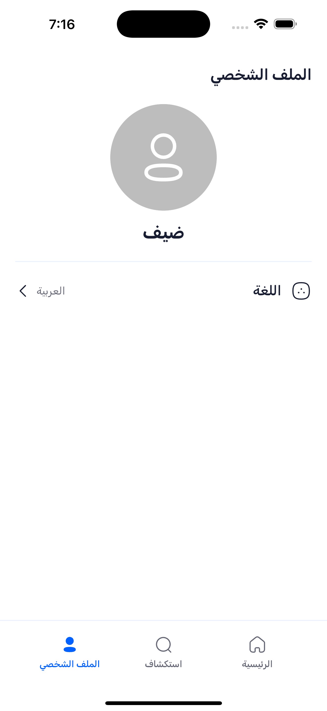 |
| Splash / Auth |  | 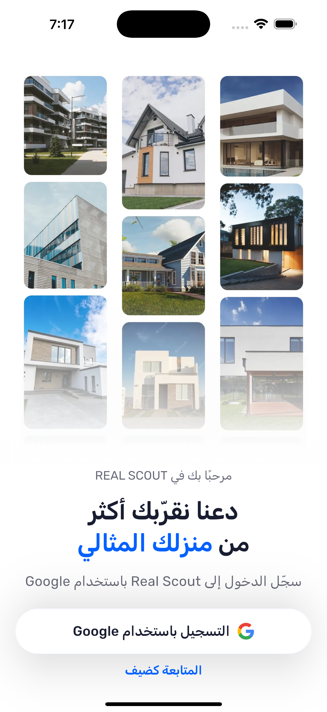 |

---

## 3. Requirements

| Tool | Version used |
| --- | --- |
| Flutter | 3.44.1 (stable) |
| Dart | 3.12.1 |
| Xcode (iOS) | 26.5. The iOS project uses Swift Package Manager, so no CocoaPods step is needed |
| Android SDK / JDK | SDK 36 / JDK 21 |

The app targets phones (iOS and Android). It was run on the iOS simulator during development, and widget tests check every screen on small, standard and large phone sizes, a tablet portrait size and landscape.

---

## 4. Getting started

```bash
git clone https://github.com/AnasAlhamadd/flutter-real-estate-assessment.git
cd flutter-real-estate-assessment
flutter pub get
flutter run
```

No API key or `.env` file is needed: DummyJSON is a public API.

Useful commands:

```bash
flutter analyze          # static analysis (0 issues expected)
flutter test             # all unit and widget tests (no network needed)
flutter build apk        # Android release build
flutter build ios        # iOS release build (needs signing for a device)
```

---

## 5. API base URL

The base URL is read at compile time from `API_BASE_URL` and defaults to `https://dummyjson.com` (`lib/core/constant/api_constants.dart`):

```dart
static const String baseUrl = String.fromEnvironment(
  'API_BASE_URL',
  defaultValue: 'https://dummyjson.com',
);
```

To point the app at another server with the same API shape:

```bash
flutter run --dart-define=API_BASE_URL=https://my-api.example.com
```

A wrong URL is also an easy way to see the error and retry states (for example `--dart-define=API_BASE_URL=https://dummyjson.com/wrong`).

Network settings (same file): connect and send timeouts 10 s, receive timeout 15 s, page size 20. In debug builds every finished request is logged once (`request: GET`, `request_status: 200 (142 ms)`, `uri: …`) by `ApiLogInterceptor`; nothing is logged in release builds.

---

## 6. Architecture

The app follows **Clean Architecture**, organized by feature. Each feature has up to three layers, and dependencies only point inwards:

```text
presentation  ──►  domain  ◄──  data
(widgets, Cubits)  (entities, repository contracts, use cases: pure Dart)
                               (models, remote/local data sources, repository implementations)
```

- **domain** has no Flutter, Dio, JSON or storage imports. Repositories return `Future<Either<Failure, T>>` (`dartz`), so errors are values, not exceptions.
- **data** implements the contracts. Data sources throw typed exceptions (`ServerException`, `NetworkException`, …); repositories catch them and return a `Failure`. Nothing above the data layer throws.
- **presentation** calls use cases only and turns a `Failure` into a translated message. Widgets never call the network.
- All concrete classes are wired in one place: `lib/injection_container.dart` (`get_it`).

### Folder structure

```text
lib/
├── main.dart                  # bindings → easy_localization → DI → runApp
├── app.dart                   # MaterialApp.router: theme, locale, router, ScreenUtil, app-wide FavoritesCubit
├── injection_container.dart   # GetIt: external → core → data sources → repositories → use cases → Cubits
├── core/
│   ├── constant/              # router, API constants, colors, text styles, sizes, asset paths, translation keys, storage keys
│   ├── error/                 # exceptions, failures, exception → failure mapper, failure → message key
│   ├── network/               # DioClient (timeouts, DioException mapping), NetworkInfo, debug request log
│   ├── localization/          # EasyLocalization setup (locales, persistence, plural rules)
│   ├── storage/               # versioned SharedPreferences envelope (schema version, timestamp, size cap)
│   ├── services/              # PhoneDialer (tel: links through url_launcher)
│   ├── usecase/ enums/ utils/ # UseCase base, RequestStatus, formatters, relative time, CancellationSignal
│   └── widget/                # shared widgets: CustomText, AppButton, AppSearchField, ErrorView, EmptyView,
│                              # AppNetworkImage, skeletons, bottom nav, back button, rating badge, …
└── feature/
    ├── splash/                # presentation only
    ├── auth/                  # presentation only (no backend sign-in exists)
    ├── home/                  # domain + data (Featured, categories, paged listing, offline copy) + presentation
    ├── search/                # Explore + Filter sheet: paged search cache, filter entities, Cubits, widgets
    ├── properties/            # shared property entities/models, full catalog + details, property cards
    ├── property_details/      # Details screen + mock "extras" layer for fields the API lacks
    ├── favorites/             # device-only favorites (domain + data + presentation)
    └── profile/               # presentation only (the locale lives in easy_localization)

assets/  fonts/ (Rubik)  svg/ (Figma icons)  images/  translations/ (en.json, ar.json)
test/    mirrors lib/ one test file per source file, plus fixtures/ and helpers/
docs/    PROJECT_REFERENCE.md (decision log, design inventory, progress log), screenshots/
```

### One request end to end

```text
User types "phone" in Explore
 → SearchCubit.onQueryChanged      300 ms debounce, normalize, ignore unchanged text, cancel the previous request
 → SearchFirstPageUseCase
 → SearchRepositoryImpl            session cache? → serve it | offline? → NetworkFailure
 → PropertiesRemoteDataSource      GET /products/search?q=phone&limit=20&skip=0&select=…
 → PropertiesResponseModel.fromJson → PropertyEntity list
 → Right(results) | Left(failure)
 → SearchCubit emits success / empty / failure (late responses from older queries are dropped)
 → BlocBuilder shows the list, the empty view, or the error view with Retry
```

---

## 7. State management

**`flutter_bloc` with Cubits**, applied the same way on every screen:

- One immutable, `Equatable` state per Cubit with a shared `RequestStatus` enum (`initial`, `loading`, `success`, `empty`, `failure`), plus `isLoadingMore` and `hasReachedMax` for pagination.
- Cubits depend on use cases only and never on `BuildContext`.
- Screens create their Cubit with `BlocProvider(create: (_) => sl<XCubit>()..load())`; Cubits are registered as factories, so each screen gets a fresh one that is closed with it.

| Cubit | Responsibility |
| --- | --- |
| `HomeCubit` | Featured, categories and recommendations in parallel, each with its own status and retry; category switching; pagination; pull to refresh; one automatic refresh when the device comes back online |
| `SearchCubit` | Browse / search / filtered modes, debounce, cancellation, stale-response protection, pagination, refresh |
| `FilterCubit` | Filter sheet draft (categories, price range), price histogram, Reset; nothing is applied until "Set Filter" |
| `PropertyDetailsCubit` | Shows the tapped list item at once, then loads full details and the extras in parallel |
| `FavoritesCubit` | One app-wide instance above the router, so a heart has the same state on every screen |

**Why Cubit rather than Bloc:** the screens react to direct method calls (load, retry, select a category), so events would only add boilerplate. Cubits keep the logic small and are easy to test with `bloc_test`. The locale isn't in a Cubit because `easy_localization` already holds, rebuilds and persists it.

---

## 8. API integration

### Endpoints

| Use | Request |
| --- | --- |
| Featured (Home) | `GET /products?sortBy=rating&order=desc&limit=5&select=…` |
| Recommendations, "All" | `GET /products?limit=20&skip=…&select=…` |
| Recommendations, one category | `GET /products/category/{slug}?limit=20&skip=…&select=…` |
| Categories | `GET /products/categories` |
| Search (Explore) | `GET /products/search?q=…&limit=20&skip=…&select=…` |
| Filtered results (full matching set) | `GET /products/search?q=…&limit=0&select=…` or `GET /products?limit=0&select=…` |
| Details | `GET /products/{id}` |

Listing requests send `select=title,price,rating,category,brand,thumbnail`, so list responses stay small (the whole catalog is about 40 KB). Only the Details request returns the full product.

### JSON → models → entities

`PropertyModel`, `PropertiesResponseModel`, `CategoryModel` and `ReviewModel` parse responses defensively: only the product `id` is required. Wrong types, blank strings, missing keys and non-finite numbers (`NaN`, `1e400`) become `null` or defaults instead of crashing; broken list entries are skipped. A response with the wrong top-level shape becomes an "unexpected response" error.

DummyJSON products are mapped to properties like this:

| UI field | API field |
| --- | --- |
| Title, description, price, rating, photos, reviews | `title`, `description`, `price`, `rating`, `thumbnail` / `images`, `reviews` |
| Category tag and chips | `category` (slug) and `/products/categories` names |
| Card "location" line | `brand`, or the category name when the product has no brand (47 % of products) |

### States, errors and retry

Every data-driven area has loading (shimmer skeletons shaped like the real cards), success, empty and error states. Errors show a translated, user-friendly message with a **Retry** button; technical details are never shown.

| What happens | Shown to the user |
| --- | --- |
| No connection (`connectivity_plus` check, or a socket/connection error) | "No internet connection. Check your network and try again." |
| Timeout | "The request took too long. Please try again." |
| HTTP 5xx | "Something went wrong on our side. Please try again later." |
| HTTP 404 / other 4xx | "We couldn't find what you're looking for." / "The request couldn't be completed." |
| Unreadable or unexpected JSON | "We received an unexpected response. Please try again." |
| Superseded request (cancelled) | Nothing; it is ignored |

- **Pagination failures** keep the loaded items and show a small retry row under them.
- **Pull to refresh** keeps the current content if the refresh fails and shows a snackbar.
- **Offline launch:** Home's first "All" page and the categories are saved on the device, so Home still shows them offline (less than 24 h old) with an "offline: showing saved results" notice.
- **Broken or missing images** never crash a screen: `AppNetworkImage` (`cached_network_image`) shows a placeholder and an error widget, and handles `null` or empty URLs.

### Avoiding unnecessary requests

- 300 ms debounce, normalized queries (trimmed, lower case), unchanged text ignored, 2-character minimum.
- The previous request is **cancelled** when a new query starts (`CancellationSignal`, converted to a Dio `CancelToken` in the data layer), and late responses are dropped.
- Session memory caches: search pages (last 20 queries, 10 min), full filtered sets (last 5, 10 min), details (last 20), categories (memory, then 24 h on disk).
- Pagination is guarded (`isLoadingMore`, `hasReachedMax`), and the Details screen reuses the tapped list item instead of waiting for the network.
- No request is ever started from `build()`.

### Local storage

`shared_preferences` holds only three small keys, each in a versioned envelope (`schemaVersion`, `cachedAt`, `data`) with a size cap: Home's first "All" page, the category list, and favorites (≤ 100 snapshots). A schema mismatch or corrupt value is deleted and treated as "no data". Cache writes are best effort: a failed write never fails the user's request. The saved language is stored by `easy_localization`.

---

## 9. Search and filtering

DummyJSON can't combine search with a category, accepts one category per request, and has no price parameters (all verified). The app therefore uses two modes:

| Mode | When | How |
| --- | --- | --- |
| **Paged** | No filter applied | Browse (fewer than 2 characters typed) or server search, 20 items per page, "Found N results" from the API `total` |
| **Full set** | A filter is applied (categories and/or price) | One `limit=0` request for the current query, then the selected categories and price range are applied on the device by `FilterPropertiesUseCase` (a pure, unit-tested function) |

- Changing filters or reopening the sheet doesn't send a new request: the sheet's histogram and the results share the same in-memory copy.
- The price histogram uses 20 buckets on a **logarithmic** scale, because prices range from $0.79 to $36,999.99 with most under $100.
- A slider thumb at the end of its track means "no limit" on that side.
- The sheet edits a draft: back closes without applying, Reset clears the draft, "Set Filter" applies it. The filter icon turns blue while a filter is applied, and an empty result offers "Clear filters".

---

## 10. Arabic/English and RTL/LTR

### How the language is switched

1. Open the **Profile** tab and tap **Language**.
2. Pick **English** or **العربية** in the bottom sheet (each language is written in its own script, and the current one is checked).
3. The app calls `context.setLocale(...)`. `easy_localization` reloads the strings and `MaterialApp.router` receives the new `locale`, so the **whole app rebuilds in place**: no restart, the current screen stays open, and Flutter's localization delegates flip `Directionality` to RTL for Arabic and LTR for English.
4. The choice is saved (`saveLocale: true`) and restored on the next launch. On the very first launch the device language is used if it is Arabic or English; otherwise English.

### How RTL/LTR is implemented

- **Only directional APIs** are used for layout: `EdgeInsetsDirectional`, `AlignmentDirectional`, `PositionedDirectional`, `TextAlign.start/end`. A code search for `left`/`right` paddings and alignments returns only the Details top bar, where the physical safe-area insets are correct on purpose.
- **Arrows and chevrons** are SVGs drawn with `matchTextDirection: true`, so back buttons and "next" chevrons point the right way in both languages.
- **Horizontal lists** (Featured, chips) start from the reading side automatically; nothing is reversed by hand.
- **All static text** is translated: titles, buttons, hints, empty/error/loading messages, navigation labels, snackbars and screen-reader labels. Every key is declared once in `AppTextKeys`, and a test checks that `en.json`, `ar.json` and `AppTextKeys` contain exactly the same keys.
- **Plurals** use real CLDR rules (`ignorePluralRules: false`), so Arabic shows the correct zero/one/two/few/many/other form (for example "Found 5 results").
- **Mixed content** stays readable: numbers and prices use Western digits through `intl` (`$12219`, `$9.99`, `4.8`). Latin-only content inside the Arabic UI (rating badges, price-range labels, the address, gallery counters) is laid out LTR so it never reorders.
- **Long text** is clamped with `maxLines` + ellipsis, and text containers never have fixed heights.
- **Font:** Rubik (bundled variable font) covers Latin and Arabic, so both languages use the same typeface. Letter spacing is dropped in Arabic because it breaks letter joins.

---

## 11. Responsive layout and design fidelity

- `flutter_screenutil` with the Figma frame size (`430 × 932`) as `designSize`; spacing uses `.w`/`.h` and fixed-ratio boxes use `.r`.
- Colors, text styles, spacing, radii and shadows come from the Figma file and live in `ColorsApp`, `AppTextStyles` and `AppSizes`. Icons are the Figma SVGs (no Material substitutes).
- Every screen scrolls inside a `SafeArea`. Grids choose 2–4 columns from the available width, and card heights follow the content and the text size.
- Widget tests render each screen at 320×568, 375×812, 430×932, 768×1024 and landscape, in English and Arabic, at text scale 1.0 and 1.3, and fail on any overflow.
- Accessibility: 44 px minimum tap targets, screen-reader labels in both languages, and animations (shimmer, card entrance, scroll effects) turn off when the system asks for reduced motion.

---

## 12. Packages and why they are used

| Package | Why |
| --- | --- |
| `flutter_bloc` + `equatable` | Cubit state management with value-equal states (fewer rebuilds, easy tests) |
| `get_it` | Dependency injection: one place wires every layer, and tests swap in fakes |
| `go_router` | Declarative routes, bottom-tab shell with per-tab state (`StatefulShellRoute`), typed path parameters (`/property/:id`) |
| `dio` | HTTP with timeouts, interceptors and request cancellation |
| `dartz` | `Either<Failure, T>` for explicit error handling across layers |
| `connectivity_plus` | Fast "no internet" answer and refresh when the connection returns. It only reports a network interface, not that the API is reachable, so real outages still surface as timeouts or connection errors |
| `shared_preferences` | Small, bounded storage: saved first page, categories, favorites (and the language through easy_localization) |
| `easy_localization` + `flutter_localizations` | JSON translations, instant locale switch, saved locale, plural rules, RTL-aware Material widgets |
| `intl` | Number and price formatting |
| `flutter_screenutil` | Scaling the Figma sizes to any phone |
| `cached_network_image` | Image caching, placeholders and error widgets for API photos |
| `flutter_svg` | Figma icons exported as SVG |
| `url_launcher` | Opens the phone dialer from the agent's call button |
| dev: `flutter_test`, `bloc_test`, `mocktail`, `flutter_lints` | Unit, Cubit and widget tests with mocks; lint rules |

---

## 13. Tests

```bash
flutter test
```

**1,050+ tests**, all passing without network access (fixtures captured from the real API, a fake Dio HTTP adapter, and `mocktail` mocks). The test tree mirrors `lib/`, one file per source file.

| Area | Examples |
| --- | --- |
| JSON parsing | Valid products, missing fields, wrong types, non-finite numbers, broken list entries |
| Network | `DioException` → typed exception mapping, request paths and query parameters, cancellation, debug log |
| Repositories | Online/offline, saved-copy fallback by error type and age, memory caches (freshness, LRU eviction), exception → failure |
| Search and filter logic | Query normalization, paged search cache, local category + price filtering, log-scale price histogram |
| Cubits | Loading → success/empty/failure, retry, pagination, refresh, debounce, stale responses, favorites save/revert |
| Widgets and screens | Every state, English and Arabic direction, long text, narrow screens at 1.3 text scale, tap targets, semantics |
| Localization | Same keys in `en.json`, `ar.json` and `AppTextKeys`; Arabic plural forms; switching language flips direction without a restart and is restored after a restart |

---

## 14. Assumptions and known limitations

### DummyJSON

- **DummyJSON does not save changes.** It simulates `POST`, `PUT`, `PATCH` and `DELETE` (it answers as if they worked), but nothing is stored on the server, and the change is gone on the next request. This app only **reads** data (`GET`); it sends no write requests and never claims that data is saved on a server.
- **Favorites are stored on this device only** (`shared_preferences`), not on the API. They survive an app restart but not an uninstall, and aren't shared between devices.
- The API is **English only**. Product titles, descriptions, categories and reviews stay in English inside the Arabic UI; searching in Arabic returns no results (the empty state is shown).
- The data is **products, not real estate**. Products are shown as properties (see the mapping in [section 8](#8-api-integration)). The category chips show the API's 24 product categories rather than the design's House/Villa/Apartments labels, so no fake data is shown.
- Prices have cents (`$9.99`), while the design shows whole numbers (`$12219`): whole prices are shown without decimals, others with two.

### Mock data (clearly separated)

Details fields that DummyJSON doesn't have use **mock values from the design**, all in one class (`PropertyExtrasMockDataSource`) so a real source can replace it without touching the UI: beds/baths/area, the agent (fictional phone number), facilities, the address and a static map image, and review like counts. Product stock or weight is never presented as bedrooms or area.

### Hidden or limited features

There are no buttons that look active but do nothing. Elements without a backing feature were either hidden or show a clear message:

- **Hidden:** notification bell, share button, Profile menu rows other than Language, avatar edit badge, the Filter sheet's bedrooms/bathrooms/building-size controls (no API fields).
- **Show "not available yet":** Google sign-in, "Booking Now", and the agent's chat button. The call button opens the phone dialer.
- **No real authentication:** the app runs as a guest ("Welcome, Guest"); there is no login API in scope.
- Home's filter icon is hidden; filters are opened from Explore. Home's "See All" opens Explore without passing the category or sort order, and Explore doesn't show the design's category chip row (categories are chosen in the Filter sheet).
- Light theme only (the design has no dark mode).

### Other notes

- Cache writes are best effort: if the device fails to save, the app keeps working with live data.
- `connectivity_plus` can't tell whether the API itself is reachable; such failures appear as timeouts or connection errors with Retry.
- Inactive carousel dots are white, as in the design, so they can be hard to see on white product photos.
- Explore's exact pixel values couldn't be re-checked against Figma (the Figma API plan limit was reached); its layout uses the shared design tokens.
- The Auth collage photos are design placeholders from the Figma file; their license is unknown.

---

## 15. AI usage

AI tools (mainly the Cursor agent, with the Figma MCP server) were used for planning, design inspection, code, tests, debugging and documentation. Every output was checked with `flutter analyze`, the test suite, live API calls and renders compared with Figma, and several suggestions were changed or rejected. The full account, with prompts, verification and rejected outputs, is in **[AI_USAGE.md](AI_USAGE.md)**.

---

## 16. Git history

Work was done in feature branches (`feature/foundation`, `feature/properties-data`, `feature/design-system`, `feature/splash`, `feature/auth`, `feature/home`, `feature/property-details`, `feature/search`, `feat/add_filter`, `feature/profile`) merged into `main`, with [Conventional Commits](https://www.conventionalcommits.org/) messages (`feat`, `fix`, `test`, `docs`, `build`, `refactor`). The full decision log, design inventory and progress log are in [`docs/PROJECT_REFERENCE.md`](docs/PROJECT_REFERENCE.md).
